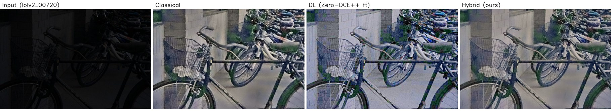
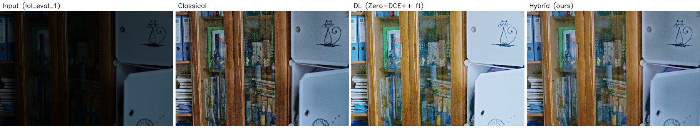
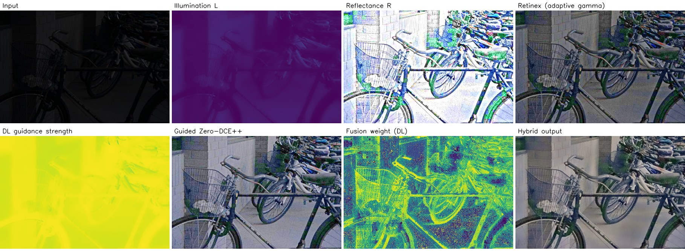

# Hackathon Technical Solution Report

| Field | Details |
| :--- | :--- |
| **Problem ID** | `P1` (CV Hackathon 2026) |
| **Problem Title** | Robust Low-Light Image Restoration and Enhancement |
| **Team Name** | `[Team name]` (Team ID `[TXX]`) |
| **Team Members** | `[Full name]`, `[USN]` (solo entry) |
| **GitHub Repository** | https://github.com/sanjitdk/lowlight-restoration-p1 (commit `de8eb10`; test metrics produced with config sha `99acdc7c802dd703`, weights sha `e48336cf2b59d626`, see `results/test_lock.json`) |
| **Live Demo / Deployment** | https://lowlight-restoration-p1.onrender.com (Gradio app in Docker on Render, CPU only; the free instance takes about 30–60 s to wake up after it has been idle) |

---

## 1. Problem Understanding & Solution Strategy

* **Core Technical Challenge:** Low-light photos combine four problems: severe underexposure (LOL inputs average about 0.06–0.10 mean luma), **sensor noise that only becomes visible once the image is brightened**, colour casts from weak or tinted light, and **non-uniform lighting**, where lamps or windows sit next to deep shadow. A single global brightening lifts the noise along with the signal, blows out the areas that were already lit and produces halos at strong edges. Our constraints were: run on a **free CPU host with 512 MB RAM** (no GPU), take about 1 s per 600×400 image, and **generalise to unseen captures** rather than only to the training dataset.
* **Proposed Methodology:** Each input is first measured: brightness, noise *after* brightening, lighting unevenness, colour cast and contrast. These numbers set the parameters of a classical Retinex pipeline and of a guided Zero-DCE++ network. The classical illumination map then controls, pixel by pixel, how strongly the network brightens, and the two outputs are blended with exposure fusion. We chose adaptive parameters over static ones because one fixed gamma, CLAHE clip or denoise strength cannot suit both a nearly black image and a moderately dim one. All parameter rules were tuned on a held-out validation split only, and the test sets were evaluated once.

---

## 2. Technical Architecture & Implementation

Pipeline overview (full diagram: `docs/architecture.md`; design rationale: `docs/design.md`):

```
input ─► analyze() ─► adaptive_params()
  │                         │
  ├─► Classical: illumination L ─► Retinex (adaptive γ) ─► guided denoise ─► CLAHE ─► colour ─┐
  │                    │                                                                  ├─► exposure fusion ─► highlight guard ─► output
  └─► DL: Zero-DCE++ ◄─┘ (L sets the curve strength per pixel) ─► noise-adaptive denoise ─────┘
```

### 2.1 Classical Algorithmic Baseline
* **Algorithms Utilized** (`src/classical.py`):
  1. **Illumination estimation:** max-RGB, refined with an edge-preserving **guided filter** to give a smooth illumination map L.
  2. **Retinex decomposition** I = R · L. Gamma is applied to L only, then recombined with the reflectance R. Shadows are lifted without flattening texture.
  3. **Edge-preserving denoising:** a guided filter, weighted towards dark regions (where amplification is largest). A bilateral filter is also available.
  4. **CLAHE** on the L channel of Lab, so the colour channels are left alone.
  5. **Colour correction:** gray-world white balance (applied only when a cast is detected) and saturation control.
* **Adaptive Selection Logic** (`src/analysis.py`: `analyze()` → `adaptive_params()`):
  * **Gamma:** γ = log(target_lum) / log(mean_lum), clamped to [0.25, 0.9]. Darker inputs get a stronger lift, and an image already at the target is left alone.
  * **CLAHE clip limit:** rises as RMS contrast falls and is reduced as noise rises, because CLAHE amplifies noise.
  * **Denoising strength:** a dark image hides its noise in absolute terms, so σ is estimated with a wavelet estimator **after** Retinex brightening. The guided-filter regularisation is then set to eps = (k·σ)². (Our first version measured σ on the raw input and almost never switched denoising on; we found and fixed this.)
  * **White balance:** applied only when the gray-world channel deviation exceeds a threshold, so warm lamplight that belongs to the scene is not neutralised.
  * Rule constants (`configs/final.yaml`) were chosen by coordinate descent **on the 50-image validation split only**, with objective J = PSNR/20 + SSIM − LPIPS. Values: denoise_k 8, radius 7, target_lum 0.35, clahe_clip_max 1.5.

### 2.2 Deep Learning Pipeline
* **Model Architecture:** **Zero-DCE++** (`src/dl/zerodce.py`). It predicts a 3-channel curve map A ∈ [−1, 1] and applies LE(x) = x + A·(x² − x) eight times. We ported the official architecture and **strict-loaded the official pretrained weights**. The parameter count matches the paper (10,561), and pretrained val PSNR is 14.46 dB, in the published range.
  * *Why this model:* it is tiny (about 52 KB), works at any resolution, and runs on CPU well under a second per image. It also has an explicit curve, which our classical illumination map can control per pixel (§2.3). In deployment it runs through **ONNX + OpenCV DNN in 96-row strips** (`src/dl/zerodce_onnx.py`), so PyTorch is not needed and the app fits in 512 MB. The difference from PyTorch is at most 5e-4, below one grey level.
* **Loss Functions & Training** (`src/dl/train.py`):
  * Zero-reference losses from the official formulation: **1600 · illumination smoothness (TV on A) + spatial consistency + 5 · colour constancy + 10 · exposure control** (16×16 patches, target 0.6).
  * Plus a **supervised L1 + SSIM term** (weight 1.0), since LOL provides paired ground truth.
  * Data: **LOL-v1 `our485`, split 435 train / 50 val (seed 42)**, with train ∩ val = ∅ checked by an assertion. Adam lr 1e-4, batch 8, 256 px crops, on CPU.
  * Best epoch chosen by val PSNR: epoch 0 (pretrained) 14.46 → **epoch 1 16.23 (kept)** → epoch 2 16.20 → epoch 3 15.75. Training was stopped early once val PSNR started to fall.

### 2.3 Hybrid Integration & Adaptive Mechanism
* **Fusion Strategy** (`src/hybrid.py`, `HybridEnhancer`):
  1. **Illumination-guided curve:** the classical map L sets the per-pixel strength of the DL curve, s = s_min + (1 − s_min)(1 − L)^p, with s_min = 0.2. Dark regions get the full curve; lamps and windows get at most 20% of it. This is how the classical prior directly controls the network.
  2. **Exposure fusion:** the classical and DL outputs are blended in a 5-level **Laplacian pyramid** with per-pixel Mertens weights (contrast × saturation × well-exposedness). The DL weight is multiplied by `fusion_dl_bias` = 2, chosen on val. Pyramid blending avoids the seams and halos that pixel-wise switching would create.
  3. **Highlight guard:** where L > 0.8, the output is never darker than the input, so light sources and lit regions are not dimmed or turned grey by fusion.
* **Decision Logic (amplification vs. noise):**
  * Noise is measured on the *brightened* DL output, and guided-filter denoising (eps = (k·σ)²) is applied **more strongly in dark regions**: blend weight floor + (1 − floor)·√(1 − L/0.5), floor 0.6. The most-amplified shadows get the most smoothing, while well-lit regions keep their texture. The guided filter follows the image's own edges, so edges are not blurred.
  * **Quality-aware selector (validated, then disabled):** we built a selector that scores the hybrid, DL and classical candidates with no-reference features (exposure error, clipping, colour cast, detail loss, residual noise; weights fitted with NNLS). Under leave-one-out on val it scored **J = 1.234, lower than always choosing the hybrid (1.256)**, so it is **disabled** in the frozen config and not presented as a contribution (`results/selector_val.json`).

---

## 3. Experimental Benchmarks & Evaluation

Protocol: all tuning on the 50-image val split. The test sets were evaluated **once** with the frozen `configs/final.yaml`; `results/test_lock.json` blocks re-runs with a changed config. All numbers come from `scripts/evaluate.py` (`results/*/summary.csv`) and are not edited by hand. The full tables are in `eval_P1_TXX.md`.

### 3.1 Quantitative Benchmarks

**LOL-v2 Real test (100 images, a capture set never used for training or tuning):**

| Approach / Model Variant | PSNR (dB) ↑ | SSIM ↑ | LPIPS ↓ / NIQE ↓ | Latency (ms / frame) |
| :--- | :---: | :---: | :---: | :---: |
| Input (no enhancement) | 9.72 | 0.196 | 0.520 / 6.79 | – |
| **Classical Baseline** (adaptive) | **20.27** | **0.779** | 0.315 / 6.87 | **265 ms** |
| Classical (fixed params) | 18.33 | 0.733 | **0.261** / **6.27** | 233 ms |
| **Deep Learning Only** (Zero-DCE++ fine-tuned) | 15.26 | 0.497 | 0.404 / 8.33 | 601 ms |
| Deep Learning (Zero-DCE++ pretrained) | 18.21 | 0.581 | 0.316 / 8.14 | 612 ms |
| **Proposed Hybrid System** (adaptive) | 18.92 | 0.761 | 0.336 / 6.89 | 846 ms |

**LOL-v1 eval15 (15 images, same capture set as training):**

| Approach / Model Variant | PSNR (dB) ↑ | SSIM ↑ | LPIPS ↓ / NIQE ↓ | Latency (ms / frame) |
| :--- | :---: | :---: | :---: | :---: |
| Input (no enhancement) | 7.77 | 0.191 | 0.560 / 6.75 | – |
| **Classical Baseline** (adaptive) | 16.05 | 0.721 | 0.335 / 6.71 | **275 ms** |
| **Deep Learning Only** (Zero-DCE++ fine-tuned) | **17.33** | 0.542 | 0.375 / 7.98 | 743 ms |
| **Proposed Hybrid System** (adaptive) | 17.21 | 0.734 | 0.331 / 6.74 | 993 ms |
| Hybrid (fixed params) | 17.11 | **0.747** | **0.261** / **6.02** | 948 ms |

*Latency: wall-clock per 600×400 image on a laptop CPU (3 threads), PyTorch backend, measured inside `evaluate.py`.*

**Deployed latency** (Render free tier: shared CPU, 1 thread, ONNX backend; 600×400 test images, warm instance, 4 requests per mode on 2026-11-07, processing time as reported by the app):

| Mode | Processing (s / image) | Full HTTP round-trip (s) |
| :--- | :---: | :---: |
| Classical | 0.55 – 0.87 (first request 2.74) | 7.1 – 10.8 |
| Deep learning | 2.8 – 3.9 | 6.3 – 8.9 |
| Hybrid | 3.4 – 4.3 | 10.9 – 16.3 |

Round-trip time includes the upload and the download of the result plus all intermediate-stage images. A cold start (instance asleep) adds about 30–60 s to the first request. The free host is roughly 4× slower than the laptop for the DL and hybrid modes.

* **Analysis:**
  * On the **in-domain** LOL-v1 set, the hybrid gets the best balance: about the same PSNR as fine-tuned DL (17.21 vs. 17.33 dB), with SSIM much higher (0.734 vs. 0.542) and lower LPIPS. **On the unseen LOL-v2 set, the adaptive classical pipeline is the best method (20.27 dB / 0.779), and our hybrid comes second (18.92 / 0.761).** The cause is that fine-tuning overfit the DL branch to LOL-v1's exposure level (−3 dB on LOL-v2 compared with the pretrained model), and the hybrid inherits this through its DL-favouring fusion weight. We report this as measured and did not re-tune on test.
  * **Fidelity vs. perception:** adaptive parameters improve PSNR/SSIM on both test sets (classical +1.9 dB on LOL-v2). However, the **fixed-parameter variants have clearly better LPIPS/NIQE (≈0.26 vs. 0.31–0.34)**, because the val-tuned denoiser (k = 8, radius 7) over-smooths fine texture.
  * **Speed:** classical ≈ 0.27 s < DL ≈ 0.6–0.75 s < hybrid ≈ 0.85–1.0 s. The hybrid costs roughly classical + DL + fusion. All three run in about 1 s on a laptop CPU, and in about 0.6–4.3 s on the free deployed host (table below).

### 3.2 Visual Outputs & Intermediate Representations
Figures are in `docs/figures/` and can be regenerated with `python scripts/make_figures.py`. They use the frozen config on test images from `examples/`.

1. **Extreme low-light** (`docs/figures/fig_extreme_lowlight.jpg`): LOL-v2 00720, mean luma 0.042. Input | Classical | DL | Hybrid.
   
2. **Non-uniform lighting** (`docs/figures/fig_nonuniform.jpg`): LOL-v1 eval image 1, non-uniformity 0.89 (a white cabinet next to a dark bookshelf). The guidance map limits brightening on the already-bright cabinet while the shelves are lifted.
   
3. **Intermediate states** (`docs/figures/fig_intermediates.jpg`): illumination map L, reflectance R, Retinex output, the DL guidance-strength map, guided Zero-DCE++ output, the per-pixel DL fusion weight, and the final hybrid. Maps use the viridis scale (dark = low, yellow = high).
   

The live app shows the same 11 intermediate stages for any uploaded image (*Pipeline* tab), plus a side-by-side of all three methods (*Comparison* tab). Worst-case grids are in `results/failures/`.

### 3.3 Ablation Study
Each row removes one component from the adaptive hybrid. ΔPSNR is in dB relative to the full hybrid (negative = the component helps). Source: `eval_P1_TXX.md`.

| Removed component | ΔPSNR LOL-v1 (15) | ΔPSNR LOL-v2 (100) | Effect on SSIM / LPIPS (LOL-v2) |
| :--- | :---: | :---: | :--- |
| Noise-adaptive denoising | −0.97 | **−2.12** | SSIM 0.761 → 0.476, LPIPS 0.336 → 0.464. Largest contribution |
| Exposure fusion (DL branch only) | **+1.06** | −1.36 | LPIPS 0.336 → 0.382. Fusion moves the output towards the better-generalising classical branch |
| CLAHE | −0.34 | −0.86 | SSIM 0.761 → 0.736 |
| Illumination guidance (classical → DL) | −0.19 | −0.44 | Small but consistent on both sets |
| Colour correction | +0.12 | −0.43 | LPIPS 0.336 → 0.347 |
| Retinex (plain gamma instead) | +0.43 | −0.25 | LPIPS 0.336 → 0.379; Retinex gives better perceptual quality on both sets |
| **Adaptive → fixed parameters** | −0.10 | −0.66 | PSNR better with adaptive, but LPIPS better with fixed (0.261) |

On the larger, unseen LOL-v2 set, **every component improves PSNR**. On the 15-image LOL-v1 set, three components (fusion, colour, Retinex) lower PSNR slightly, and we report that as it is. Classical guidance of the DL curve helps consistently, but only by a small amount (+0.2 to +0.4 dB), which is expected: LOL scenes are mostly uniformly dark, so the per-pixel guidance has little to protect.

---

## 4. Failure Modes & Limitations

* **Observed Failure Case 1: over-exposure of moderately dark scenes** (LOL-v2 00718, 00719, 00728–00730; `results/failures/test_lolv2_*.jpg`). These shaded *daytime* scenes come out washed out: mean luma is +0.09 to +0.18 above the ground truth, with a colour shift of 0.11–0.20. 00728 is also over-smoothed (residual σ 0.013 vs. 0.035 in the GT).
* **Observed Failure Case 2: under-exposure of very dark, non-uniform scenes** (LOL-v1 23 and 55): mean luma −0.20 to −0.22 below the GT. A third case, LOL-v1 179, shows a colour shift (0.24) under mixed lighting.
* **Root Cause:**
  1. Zero-DCE++ applies a fixed curve iteration, and fine-tuning taught it the **global exposure level of LOL-v1** rather than an exposure relative to the input. On an input that is only moderately dark it still pushes towards that level. The hybrid's fusion weight favours DL (`fusion_dl_bias` = 2, chosen on LOL-v1 val), so the classical branch cannot correct it. The classical gamma rule γ = log(target)/log(mean) is input-relative, which is why classical generalises better.
  2. `target_lum` = 0.35 (val-tuned for SSIM/LPIPS) is darker than the GT photographer's style for very dark scenes, and the guidance map deliberately holds back brightening near the bright region.
  3. Gray-world assumes the average scene colour is neutral. A dominant coloured surface breaks that assumption.
  4. Over-smoothing: denoising with eps = (k·σ)² and k = 8 removes texture together with noise. The PSNR/SSIM terms in the objective reward smoothness more than the LPIPS term penalises it.
* **Mitigation (proposed; not applied, because choosing it from test results would leak test information):**
  * Make the DL exposure **input-relative**: scale the curve strength by the measured brightness gap (target − mean_lum), or condition the network on it. Alternatively, cap the fusion DL weight when the input is already moderately bright.
  * Choose `fusion_dl_bias` and `target_lum` on a **cross-dataset validation set** (for example, part of LOL-v2 train) instead of LOL-v1 only.
  * Tune the denoiser with **LPIPS compared against the fixed-parameter baseline** and a lower k, or switch to a texture-preserving denoiser such as non-local means in the dark regions only.
  * Replace gray-world with **gray-edge / shades-of-gray** illuminant estimation, which is more robust to dominant colours.

**Other limitations:** the model was tuned and fine-tuned only on LOL (indoor, static scenes), so night scenes with strong point light sources are less well covered. Several tuned values sit at the edge of their search grid. PSNR penalises plausible alternative exposures. Outputs are plausible reconstructions and must not be used as forensic evidence.

---

## 5. Deployment & Quickstart Guide

### Quickstart Commands
```bash
# 1. Clone the repository and install dependencies (CPU only; no PyTorch needed for inference)
git clone https://github.com/sanjitdk/lowlight-restoration-p1.git
cd lowlight-restoration-p1
pip install -r requirements.txt

# 2. Run inference on a sample directory (frozen config; modes: hybrid | classical | dl | all)
python scripts/run_inference.py --input_dir ./examples/ --output_dir ./results/inference/ --mode all
#    add --save_intermediates to also save illumination / guidance / fusion maps

# 3. Launch the web app locally → http://localhost:7860
python app.py
#    or with Docker:
docker build -t lowlight . && docker run -p 7860:7860 lowlight

# 4. Reproduce the metrics (needs requirements-dev.txt + LOL data in data/, see README)
pip install -r requirements-dev.txt
python scripts/evaluate.py --split test_lol
python scripts/evaluate.py --split test_lolv2
```

### Deployment Format
* **Gradio 4.44 web app** (`app.py`) packaged as a **Docker container** (`Dockerfile`: python:3.10-slim, non-root user, port 7860) and deployed on **Render** (free tier, 512 MB RAM, CPU; `render.yaml` Blueprint). We first targeted Hugging Face Spaces, but Gradio/Docker Spaces there now require a paid plan.
* **Runtime:** the DL branch runs as **ONNX through OpenCV DNN** (`weights/zerodcepp_finetuned.onnx`), processed in strips with a halo, so the container does not need PyTorch and peaks at about 310 MB. Large JPEGs are decoded at reduced scale and capped at 768 px (`APP_MAX_SIDE`).
* **App features:** before/after comparison slider, a side-by-side comparison of all three methods with timing, the 11 pipeline intermediates, the measured input statistics and the adaptive parameters chosen for that image. Invalid inputs (corrupt, tiny or huge files) get a clear error message. Uploaded images are not stored.
* **CLI:** `scripts/run_inference.py` for batch folders; `scripts/evaluate.py` for full metric evaluation.

---

### Student Submission Checklist
- [x] Working GitHub repository link included with an updated `README.md`.
- [x] No raw code pasted into this report.
- [x] All table metrics match test runs reproducible via the repository (`scripts/evaluate.py` → `results/*/summary.csv` → `eval_P1_TXX.md`).
- [ ] All team member details accurately recorded. *(Fill in Team name, Team ID and USN in the header.)*
