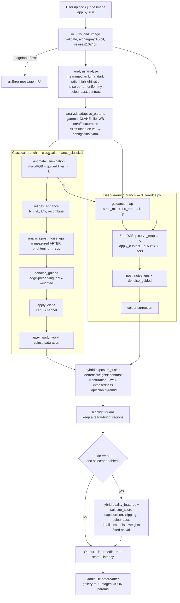

# System Architecture

Every box below is a function in `src/`. File and function names are shown, so the diagram can be checked against the code.



## Offline pipeline (training, tuning, evaluation)

```mermaid
flowchart LR
    D1[(LOL-v1 our485)] --> SP[scripts/make_splits.py<br/>seed 42]
    SP --> TR[train.txt 435]
    SP --> VA[val.txt 50]
    D2[(LOL-v1 eval15)] --> TE[test_lol 15]
    D3[(LOL-v2 Real test)] --> TE2[test_lolv2 100]
    TR --> FT[src/dl/train.py<br/>zero-ref losses + L1/SSIM]
    VA --> FT
    FT --> W[weights/zerodcepp_finetuned.pth<br/>best val epoch]
    W --> TU[scripts/tune_val.py<br/>coordinate descent on val]
    VA --> TU
    TU --> CFG[configs/final.yaml FROZEN]
    VA --> FS[scripts/fit_selector.py<br/>NNLS + leave-one-out]
    CFG --> FS --> CFG
    CFG --> EV[scripts/evaluate.py<br/>methods + ablations]
    TE --> EV
    TE2 --> EV
    EV --> R[results/*/summary.csv<br/>eval_P1_TeamID.md]
    EV -. test_lock.json .-> EV
```

## Module map
| File | Responsibility |
|---|---|
| `src/io_utils.py` | Safe decoding, format normalisation, size limits, user-facing errors |
| `src/analysis.py` | Image statistics, adaptive parameter rules, post-brightening noise estimate |
| `src/classical.py` | Guided filter, illumination estimation, Retinex, CLAHE, denoising, colour correction |
| `src/dl/zerodce.py` | Zero-DCE++ network (official layer names), strict loading, guided inference |
| `src/dl/train.py` | Fine-tuning on train split, val-based checkpoint selection |
| `src/hybrid.py` | Guidance, fusion, highlight guard, quality selector, `HybridEnhancer` |
| `src/metrics.py` | PSNR, SSIM, LPIPS, NIQE, noise σ, edge correlation / F1, timing |
| `app.py` | Gradio interface |
