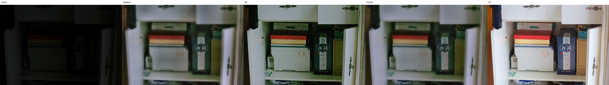
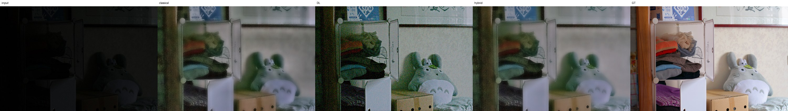
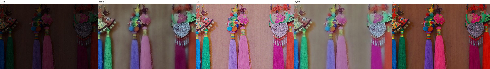

# Failure cases — worst 3 by hybrid PSNR on test_lol

## 55.png — PSNR 12.31 dB, SSIM 0.689, LPIPS 0.410

Diagnosis (automatic, from measured statistics):

- under-exposed vs. GT (mean luma -0.22)
- strongly non-uniform lighting (0.72)
- colour shift vs. GT (max channel-mean diff 0.25)

## 23.png — PSNR 12.50 dB, SSIM 0.676, LPIPS 0.468

Diagnosis (automatic, from measured statistics):

- under-exposed vs. GT (mean luma -0.20)
- strongly non-uniform lighting (0.71)
- colour shift vs. GT (max channel-mean diff 0.25)

## 179.png — PSNR 13.64 dB, SSIM 0.636, LPIPS 0.388

Diagnosis (automatic, from measured statistics):

- over-exposed vs. GT (mean luma +0.19)
- colour shift vs. GT (max channel-mean diff 0.24)

