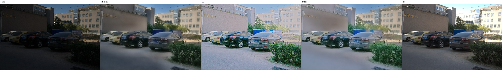
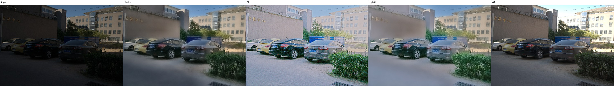
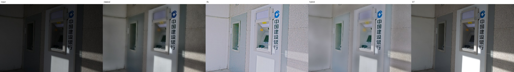
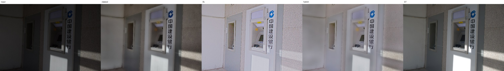
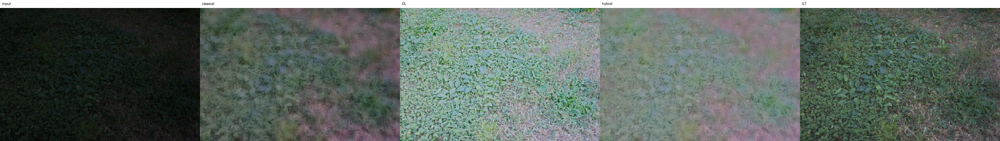

# Failure cases — worst 5 by hybrid PSNR on test_lolv2

## 00719.png — PSNR 13.51 dB, SSIM 0.734, LPIPS 0.296

Diagnosis (automatic, from measured statistics):

- over-exposed vs. GT (mean luma +0.09)
- strongly non-uniform lighting (0.84)
- colour shift vs. GT (max channel-mean diff 0.12)

## 00718.png — PSNR 13.53 dB, SSIM 0.731, LPIPS 0.291

Diagnosis (automatic, from measured statistics):

- over-exposed vs. GT (mean luma +0.09)
- strongly non-uniform lighting (0.83)
- colour shift vs. GT (max channel-mean diff 0.11)

## 00730.png — PSNR 13.55 dB, SSIM 0.797, LPIPS 0.234

Diagnosis (automatic, from measured statistics):

- over-exposed vs. GT (mean luma +0.16)
- strongly non-uniform lighting (0.69)
- colour shift vs. GT (max channel-mean diff 0.19)

## 00729.png — PSNR 13.69 dB, SSIM 0.801, LPIPS 0.230

Diagnosis (automatic, from measured statistics):

- over-exposed vs. GT (mean luma +0.16)
- strongly non-uniform lighting (0.68)
- colour shift vs. GT (max channel-mean diff 0.17)

## 00728.png — PSNR 14.02 dB, SSIM 0.553, LPIPS 0.520

Diagnosis (automatic, from measured statistics):

- over-exposed vs. GT (mean luma +0.18)
- colour shift vs. GT (max channel-mean diff 0.20)
- over-smoothed (σ 0.013 vs. GT 0.035)

